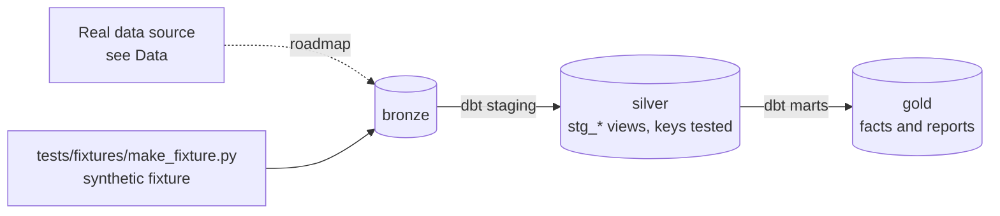

# Procurement Spend Cube & Supplier Analytics

[](https://github.com/Saigwe/procurement-spend-cube/actions/workflows/ci.yml)

> A spend cube on real public procurement data: supplier normalisation, an evaluated spend classifier, tail-spend and consolidation opportunities, and working-capital (DPO) metrics, packaged to run for many clients.

**Author:** Stanley Igwe, Lead Data (Analytics) Engineer · [Portfolio](https://saigwe.github.io)
**Stack:** dlt or Python ingestion · DuckDB · dbt Core (packaged per client) · rapidfuzz · an LLM or embeddings classifier · Power BI or Evidence.dev
**Status:** 🚧 Scaffolded. Fixture pipeline passes: `dbt build` 20/20. See [Roadmap](#roadmap).

Project 10 of my portfolio plan. At a global management consultancy I delivered modular procurement analytics (spend, supplier negotiation, category insights, working capital and DPO) with governed metrics, deployed to hundreds of clients a year. This repo rebuilds the problem on public and synthetic data. No employer or client data, code or logic is used.

---

## 90-second summary
| | |
|---|---|
| **Problem** | TODO: one sentence on the business problem. |
| **What I built** | TODO: fill in as the roadmap lands. |
| **Why it matters** | TODO: the decision this enables, in the user's words. |
| **Proof** | TODO: link to [Numbers](#numbers), with every claim reproducible. |

## Architecture


## Data
Real data: [USAspending.gov](https://www.usaspending.gov/download_center/custom_award_data) federal contract awards or UK [Contracts Finder](https://www.contractsfinder.service.gov.uk/). Add a synthetic invoice and payment-terms table for DPO. CI uses a synthetic supplier and spend-line fixture with a keyword taxonomy.

| Bronze table (fixture) | Rows |
|---|---|
| `bronze.suppliers` | 300 |
| `bronze.taxonomy_rules` | 8 reference rows |
| `bronze.spend_lines` | 8,000 |

## Data model (gold layer, first cut)
| Model | Purpose |
|---|---|
| `fct_spend_line` | One row per spend line with its category from the keyword taxonomy (the first matching rule wins). |
| `rpt_supplier_pareto` | Supplier Pareto: cumulative share of spend; the tail is suppliers outside the top 80% of spend. |
| `rpt_spend_cube` | Spend by category, sub-category and quarter. |

## Tests in place
- Staging: `unique` / `not_null` on every key, and `relationships` on every foreign key
- Marts: grain tests (`unique_combination`) and accepted values
- Business rules: `assert_every_line_classified`

## Numbers
*(Fill from real runs. Never estimate.)*
| Metric | Value |
|---|---|
| Rows processed (real data) | _tbd_ |
| dbt models / tests | _tbd_ |
| `dbt build` runtime | _tbd_ |

## How to run
Requires **Python 3.12** (what CI uses) and `make`, or run the commands in the `Makefile` by hand.
```bash
python -m venv .venv && source .venv/bin/activate   # Windows: .venv\Scripts\activate
pip install -r requirements.txt
make fixture-all   # synthetic fixture -> dbt build (used in CI)
```

## Roadmap
- [x] Scaffold: synthetic fixture, staging with key tests, first marts and business-rule tests, CI
- [ ] Load one fiscal year of USAspending awards for one agency
- [ ] Normalise and fuzzy-match supplier names (rapidfuzz), and measure merge precision on a sample
- [ ] Classify spend: keyword rules first, then an LLM or embeddings model, with accuracy on 300 hand-labelled lines
- [ ] Spend cube by category, supplier and quarter, with Pareto, tail spend and consolidation opportunities
- [ ] Working capital: DPO and the cash impact of moving payment terms
- [ ] Fold in project 11: package the models with per-client variables and adapters, and run a CI matrix over three synthetic clients
- [ ] Fill in [Numbers](#numbers) and the [design doc](docs/design_doc.md)
- [ ] 3-minute Loom walkthrough

## Interview topics this project prepares
- Spend classification and taxonomies
- Entity resolution
- Working-capital metrics
- Packaging analytics for many clients

## Data and licence
- **Fixture:** synthetic, generated with a fixed seed by `tests/fixtures/make_fixture.py` from `fixture_spec.yml`. It describes no real company or person.
- **Real data:** see [Data](#data) for each source's own licence and terms.
- **Code:** MIT (see `LICENSE`).
