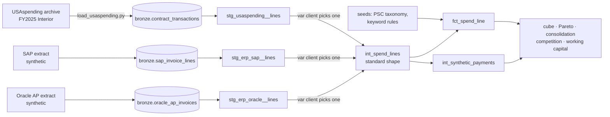

# Procurement Spend Cube & Supplier Analytics

[](https://github.com/Saigwe/procurement-spend-cube/actions/workflows/ci.yml)

> A spend cube on $7.48B of real federal contract obligations (41,980 actions, Department of the Interior FY2025): supplier rollup and name matching scored against registry IDs, a spend classifier scored against PSC codes, Pareto and tail-spend consolidation, and working-capital metrics. One dbt project, three client adapters, a CI matrix over all three.

**Author:** Stanley Igwe, Lead Data (Analytics) Engineer · [Portfolio](https://saigwe.github.io)
**Stack:** Python · DuckDB · dbt Core (seeds, unit tests, per-client adapters) · rapidfuzz · scikit-learn · GitHub Actions (matrix)
**Status:** Core build complete on real USAspending data. See [Roadmap](#roadmap).

Project 10 (with project 11 folded in) of my portfolio plan. At a global management consultancy I delivered modular procurement analytics (spend, supplier negotiation, category insights, working capital and DPO) deployed to many clients a year. This repo rebuilds the problem on public and synthetic data. No employer or client data, code or logic is used.

---

## 90-second summary
| | |
|---|---|
| **Problem** | Procurement leaders can't negotiate what they can't see: spend sits in ERP extracts with inconsistent supplier names and free-text descriptions, and every client's extract looks different. |
| **What I built** | A dbt spend cube that maps any client extract to one standard spend line through a small adapter, categorises it (PSC taxonomy, keyword fallback), rolls suppliers up to parents and produces Pareto, tail-spend, competition and working-capital marts. Every dollar reconciles back to source in a test. Two evaluations against real ground truth: supplier name matching against UEIs, and text classification against PSC categories. |
| **Why it matters** | 497 of 8,144 suppliers (6.1%) hold 80% of spend; the 7,647-supplier tail holds $1.36B. That is where consolidation starts. |
| **Proof** | [Numbers](#numbers), from `make all` on the real file. Full outputs in [`results/`](results). |

## Architecture


Onboarding a client means writing one staging adapter; nothing downstream changes. `--vars '{client: erp_sap}'` switches the whole project, and an unknown client fails at compile time.

## Data
- **Real:** [USAspending.gov](https://files.usaspending.gov/award_data_archive/) contract archive `FY2025_014_Contracts_Full` (Department of the Interior, federal FY2025): 41,980 contract actions, 30,111 awards, 10,373 recipients. Public domain. Loaded by [`ingestion/load_usaspending.py`](ingestion).
- **Synthetic:** payment dates (USAspending records obligations, not payments), clearly labelled as such in `int_synthetic_payments`. The SAP and Oracle extracts and the CI fixtures are generated with a fixed seed by `tests/fixtures/make_fixtures.py`.

## Data model
| Model | Purpose |
|---|---|
| `int_spend_lines` | The standard spend line (supplier, parent, org unit, fiscal quarter, amount, description, PSC) from the active client's adapter. |
| `fct_spend_line` | Category by longest PSC prefix, else the highest-priority keyword rule, else Unclassified, with the source of the decision. |
| `dim_supplier` | Parent supplier with child entities, raw name variants and net spend. |
| `rpt_spend_cube` | Category × org unit × fiscal quarter: gross obligations, de-obligations and net kept separate. |
| `rpt_supplier_pareto` | Supplier rank and cumulative share; the tail is everything outside the top 80%. |
| `rpt_category_consolidation` | Per category: suppliers, suppliers for 80%, tail count and spend, top-supplier share, illustrative savings. |
| `rpt_competition` | Not-competed and small-business shares by category. |
| `rpt_working_capital` | Days payable, late and early shares, late interest and early-payment float by org unit. |

## Tests
- **Reconciliation:** the cube, the supplier rollup and the line fact all equal source net spend to the cent, and gross plus de-obligations equal net.
- **Coverage:** at most 2% of gross obligations may be Unclassified.
- **Pareto:** cumulative share ends at exactly 1 and the tail never starts at rank 1.
- **Grain:** keys `unique`/`not_null`, cube grain `unique_combination`, accepted values on the category source.
- **Unit test:** longest PSC prefix beats a shorter one, then keyword priority, then Unclassified, and negative lines are flagged as de-obligations.
- **CI matrix:** the full build runs for `usaspending`, `erp_sap` and `erp_oracle` on every push.

## Numbers
All from `make all` on the real file, except working capital, which uses synthetic payment dates.

| Metric | Value |
|---|---|
| Contract actions processed | 41,980 (load 1.1 s) |
| Gross obligations / de-obligations / net | $7,478.4M / −$908.9M (6,673 actions) / $6,569.6M |
| dbt build | 31 nodes pass (10 models, 2 seeds, 18 data tests, 1 unit test) in about 2 s |
| Spend categorised from PSC code | 100.00% of absolute spend (one zero-dollar line unclassified) |
| Suppliers holding 80% of spend | 497 of 8,144 (6.1%) |
| Tail suppliers / tail spend | 7,647 / $1,356.5M |
| Illustrative consolidation savings (5% of tail) | $67.5M |
| Not competed / small business share of obligations | 11.9% / 52.9% |
| Supplier rollup | 10,373 UEIs into 10,180 parents; 106 parents with more than one entity (up to 23) |
| Days payable / paid late (synthetic) | 24.3 days / 9.2% on 30-day terms |

**Supplier name matching** ([results](results/supplier_matching.md)): 11,097 distinct (UEI, raw name) records; 703 UEIs appear under more than one spelling.

| Method | Precision | Recall | F1 |
|---|---:|---:|---:|
| Normalised name, exact (baseline) | 0.634 | 0.773 | 0.696 |
| Fuzzy token_sort_ratio ≥ 95 | 0.629 | 0.784 | 0.698 |
| Fuzzy token_sort_ratio ≥ 90 | 0.623 | 0.816 | 0.707 |
| Fuzzy token_sort_ratio ≥ 85 | 0.564 | 0.827 | 0.671 |

Fuzzy matching adds recall, but precision is capped near 0.63 because different legal entities share names (franchisees, joint ventures, regional subsidiaries). So the warehouse keys suppliers on the registry ID and uses name matching only where a client has no ID.

**Spend classification from descriptions** ([results](results/classification.md)): hide the PSC and predict the category from text, on 7,773 test lines from awards held out of training.

| Method | Accuracy | Macro F1 | Spend-weighted accuracy |
|---|---:|---:|---:|
| Keyword rules (fire on 39% of lines) | 0.226 | 0.297 | 0.163 |
| TF-IDF + logistic regression | 0.745 | 0.698 | 0.639 |
| Hybrid: model, rule overrides when model is unsure | 0.738 | 0.678 | 0.560 |

Keyword rules are right 58% of the time when they fire and lower accuracy even as a tie-breaker. For ERP clients without a product code, the trained model should replace them.

**Largest categories** ([full table](results/spend_cube.md)): construction & engineering $1.56B (540 suppliers, 62 make up 80%), IT & telecom $1.38B (890 suppliers, 69), facilities & maintenance $1.31B (2,531 suppliers, 124: the most fragmented).

## How to run
Requires **Python 3.12** (what CI uses) and `make`, or run the commands in the `Makefile` by hand.
```bash
python -m venv .venv && source .venv/bin/activate   # Windows: .venv\Scripts\activate
pip install -r requirements.txt
make download && make all                 # real data: load, dbt seed + build, analyses -> results/
make fixture-all CLIENT=erp_sap           # synthetic fixture for one client adapter (CI runs all three)
```

## Roadmap
- [x] Scaffold: fixture, staging with key tests, first marts, CI
- [x] Load one fiscal year of USAspending awards for one agency
- [x] Supplier rollup to parents, and fuzzy name matching scored against UEI ground truth
- [x] Classify spend: PSC taxonomy, keyword rules, and a text model scored against PSC labels
- [x] Spend cube by category, org unit and quarter, with Pareto, tail spend and consolidation
- [x] Working capital: DPO, late interest and early-payment float (synthetic payments)
- [x] Project 11 folded in: per-client adapters and a CI matrix over three clients
- [ ] Embeddings or LLM classifier against the same PSC test set (needs an API key)
- [ ] Payment-terms scenario: cash impact of moving terms from 30 to 45 days
- [ ] Dashboard (Evidence.dev) and a 3-minute Loom walkthrough ([script ready](docs/walkthrough.md))

## Interview topics this project prepares
- Spend classification and taxonomies, and how to evaluate a classifier honestly
- Entity resolution: precision vs recall, and why registry IDs beat names
- Working-capital metrics (DPO, late interest, float)
- Packaging one analytics product for many clients

## Data and licence
- **USAspending:** U.S. government data, public domain.
- **Synthetic data:** payment dates, ERP extracts and CI fixtures, generated with fixed seeds. They describe no real company or person.
- **Code:** MIT (see `LICENSE`).
